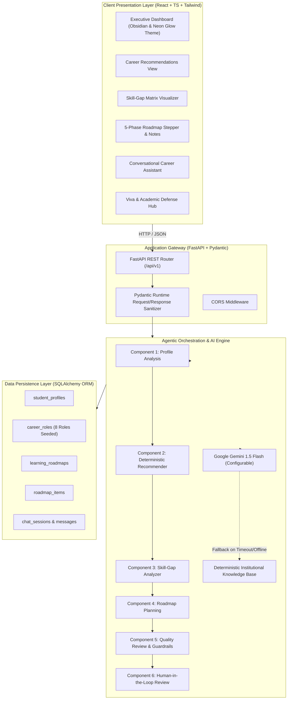

# System Architecture: Intelligent Career Path Planning Agent

## 1. Executive Summary & Abstract
The **Intelligent Career Path Planning Agent** is an explainable full-stack decision-support system designed for engineering students in **Artificial Intelligence and Data Science**. It addresses the prevalent dilemma of career uncertainty, misaligned skill preparation, and opaque online career advice.

The system combines:
1. **Deterministic Multi-Factor Scoring**: Transparent mathematical evaluation based on declared skills (40%), interests (30%), field preference (15%), experience level (10%), and goals (5%).
2. **Three-Tier Skill-Gap Matrix**: Distinguishes between confirmed reported skills, partially developed foundational concepts, and unreported competencies.
3. **5-Phase Curriculum Roadmap Generator**: Generates actionable, progressive milestones respecting weekly study hour constraints and verified learning resources.
4. **Controlled Agentic Workflow**: Coordinates 6 distinct analytical components with quality guardrails and human-in-the-loop approval before persistence.
5. **Conversational Career Assistant**: Incorporates Google Gemini with a 100% deterministic knowledge-grounded fallback ensuring resilience in offline evaluations.

---

## 2. Architectural Blueprint

---

## 3. Technology Stack Justification

| Technology | Role | Justification for College Project |
| :--- | :--- | :--- |
| **Python 3.11** | Backend Language | Dominant language in AI & Data Science; rich ecosystem for statistical analysis and machine learning. |
| **FastAPI** | REST API Framework | Asynchronous performance, automatic OpenAPI/Swagger documentation (`/docs`), seamless Pydantic integration. |
| **Pydantic v2** | Data Validation | Enforces strict type schemas, preventing runtime exceptions and malformed requests. |
| **SQLAlchemy 2.0** | Object-Relational Mapping | Decouples SQL syntax from business logic; facilitates cross-database support (SQLite for local runs, PostgreSQL for production). |
| **React 18 + TypeScript** | Client Frontend | Component reusability, compile-time type safety, robust UI state management. |
| **Tailwind CSS** | Styling System | Utility-first styling enabling the dark obsidian and neon violet glow dashboard aesthetic. |
| **Vite** | Build Tool | Sub-second Hot Module Replacement (HMR) and optimized ES module bundling. |
| **Pytest** | Automated Testing | Comprehensive unit and integration testing covering all 11 core functional modules. |
