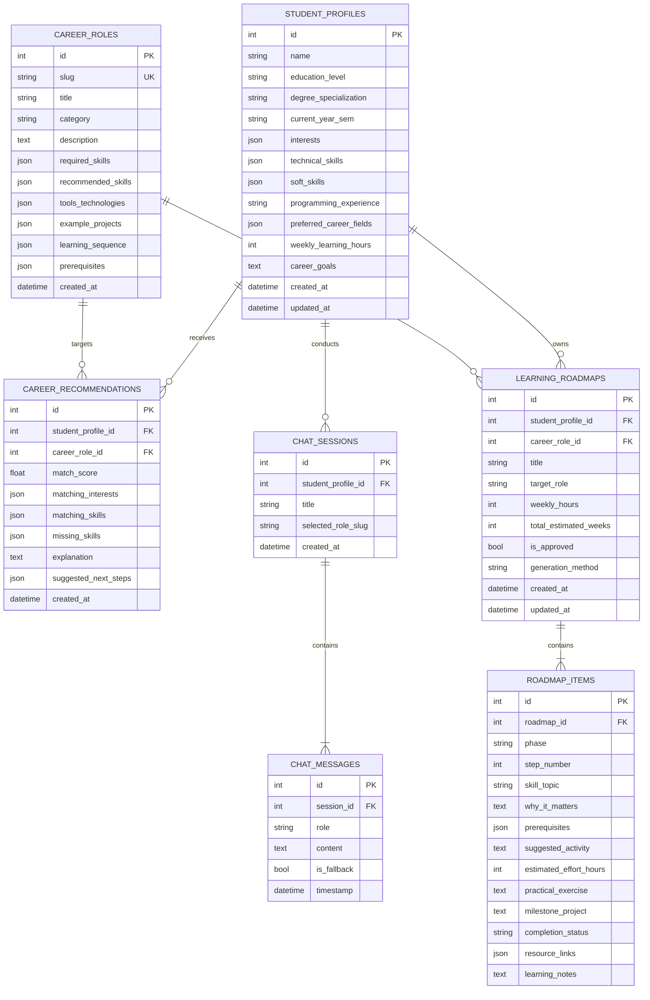

# Database Design & Entity-Relationship (ER) Documentation

## 1. Database Architecture Overview
The system uses a normalized relational database design managed through **SQLAlchemy ORM**. It operates on **SQLite** for rapid, zero-setup local development and directly connects to **PostgreSQL** in production by updating `DATABASE_URL` in `.env`.

---

## 2. Entity-Relationship Diagram

---

## 3. Seeded Career Roles

The database is initialized with 8 complete career profiles:
1. **Machine Learning Engineer** (`ml-engineer`)
2. **AI Engineer** (`ai-engineer`)
3. **Data Analyst** (`data-analyst`)
4. **Data Scientist** (`data-scientist`)
5. **Backend Developer** (`backend-developer`)
6. **Data Engineer** (`data-engineer`)
7. **MLOps Engineer** (`mlops-engineer`)
8. **AI Product Engineer** (`ai-product-engineer`)
